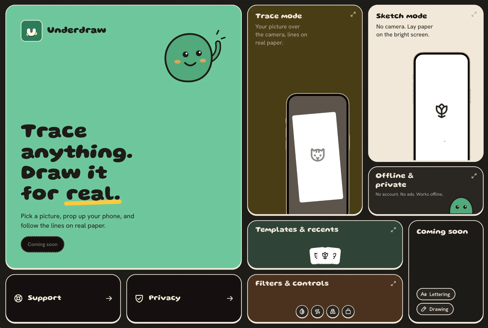

Underdraw helps you draw by tracing. Pick an image and it appears semi-transparent over the live rear-camera feed, so you can trace it onto the paper below your phone. There is also a no-camera **sketch mode**, which shows the image full-screen at max brightness so you can trace with paper on top of the screen.

It's built with **Expo (SDK 57)** and **React Native**, and is fully offline: no accounts and no analytics.

## Features

- **Trace mode** – overlay an image on the camera, then move, scale and rotate it with two fingers. You can also adjust opacity, lock, flip, reset and use the torch.
- **Sketch mode** – the image on a bright white screen.
- **Editor** – original, grayscale and outline line-art filters, plus crop.
- **Home** – 108 starter templates in 9 categories, recents, and resume where you left off.
- **Light and dark theme**, onboarding, and a camera and photo permission flow.

## 🛠️ Tech Stack

- **Expo + expo-router** – dev builds and tag-driven EAS releases for iOS and Android
- **react-native-vision-camera v5** – live camera feed and torch
- **Reanimated + Gesture Handler** – overlay transforms on the UI thread for 60fps
- **React Native Skia** – image filters, run once on the overlay rather than per camera frame
- **Uniwind (Tailwind v4)** – styling with a custom design system, Gluten and Hanken Grotesk fonts
- **Zustand + MMKV** – persisted settings and recents
- **Next.js** – marketing site with privacy policy and support pages
